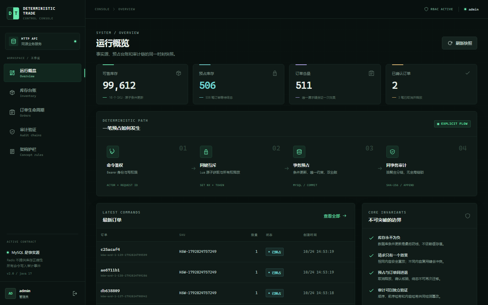
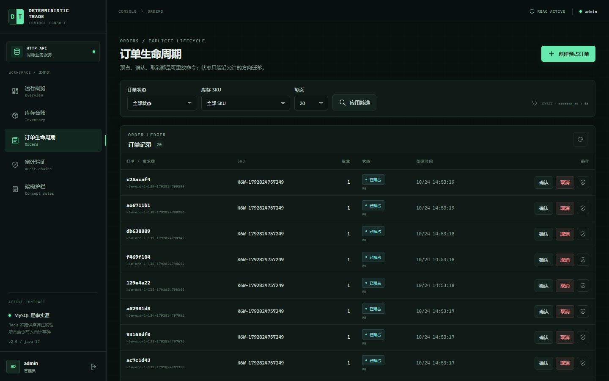
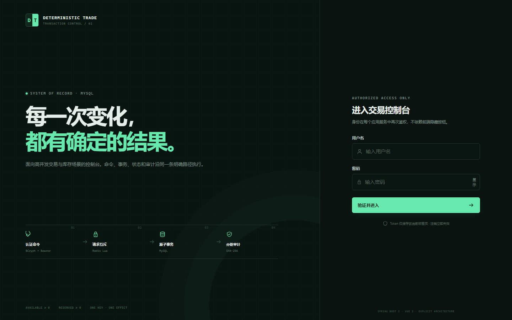

# Deterministic Trade Console

[](https://github.com/skyline019/deterministic-trade-console/actions/workflows/ci.yml)
[](LICENSE)
[](pom.xml)
[](frontend/package.json)

Single-warehouse inventory trading console: **MySQL as the sole stock fact source**, idempotent reserve / confirm / cancel / reschedule, hexagonal Java + Vue, and a multi-layer proof suite.

> Portfolio sample — **not** multi-active multi-write, not a full IdP, not a capacity SLA. See [ADR 001](docs/adr/001-idp-and-multi-active.md).

单仓确定性库存交易台：预占 / 确认 / 取消，过期显式释放，审计验链——用条件更新与回执证明正确性，而不是用缓存或异步掩盖。

<p align="center">
  
  
</p>

<p align="center">
  
  
</p>

## Features

- Dual inventory ledger — reserve, cancel (release), confirm (consume); TTL + `expire-reservations`
- Partial confirm & reservation reschedule ([ADR 002](docs/adr/002-partial-confirm.md), [ADR 003](docs/adr/003-reservation-reschedule.md))
- Three idempotency namespaces; MySQL conditional updates; Redis mutex / throttle only (fail-closed)
- Bearer (default) or Cookie; optional JWT (HS256 / static JWKS); application RBAC
- Split audit chains; ArchUnit · concept jtest · Testcontainers IT · Playwright

## Consistency (bottom line)

**MySQL is the fact source for inventory, orders, receipts, and audit. Redis does not store stock.**

Place path: request lock → write txn → receipt lookup → atomic reserve → insert order → audit → commit → owner-checked unlock. Unique-key losers roll back, then replay the winner. Bypass-the-lock IT still cannot oversell. This is **not** cross-system exactly-once.

Full matrix: [docs/consistency.md](docs/consistency.md).

## Quick start

```bash
# bootstrap password (or set in ops/secrets/.env)
export BOOTSTRAP_ADMIN_PASSWORD='local-admin-only'

docker compose up --build -d
curl -s http://localhost:8080/actuator/health
```

Open **http://localhost:8080** — `admin` / `local-admin-only` (created on first empty boot).

```bash
./scripts/smoke.sh     # login → inventory → place → replay → cancel → audit
./scripts/contend.sh   # 100 HTTP requests contend for 50 units
```

HTTPS console (Cookie path): https://localhost:8443

<details>
<summary>Demo UI only (in-memory — <strong>not</strong> evidence)</summary>

```bash
cd frontend && npm ci && npm run dev:demo
```

http://localhost:5173 — `admin` / `operator` / `viewer` / `auditor`, password `deterministic-demo`.

Sidebar shows `HTTP API` or `LOCAL DEMO`. Prefer Compose for reviews.

</details>

<details>
<summary>Local HTTP + Vite (without full Compose app image)</summary>

```bash
docker compose up -d mysql redis
export BOOTSTRAP_ADMIN_PASSWORD='local-admin-only'
./mvnw spring-boot:run
cd frontend && npm ci && npm run dev
```

</details>

## Verification

| Layer | Command | Covers |
| --- | --- | --- |
| ArchUnit + JUnit + jtest | `./mvnw verify` | Hexagon rules, correctness, RBAC, audit |
| Integration IT | `./mvnw -Pintegration verify` | MySQL + Redis (Testcontainers) |
| Vue unit + build | `cd frontend && npm ci && npm test && npm run build` | Contracts |
| Browser E2E (Demo) | `npm run test:e2e:demo` | UI flows — **not** same-origin proof |
| Black-box | `./scripts/smoke.sh`, `contend.sh` | Running Compose stack |
| Maintenance drill | `./scripts/ci-maintenance-check.sh` | Archive relocation, expiry sweep, V6 index |
| Same-origin / cookie E2E | `npm run test:e2e:same-origin`, `test:e2e:https-cookie` | Boot-served UI, `__Host-` cookie + CSRF |

CI runs all five layers ([workflow](.github/workflows/ci.yml)): `architecture-and-core`, `vue-console`,
`mysql-redis-concurrency` (Testcontainers: migrations, archive relocation, contention) and
`compose-stack` (image build, Compose smoke + contention + maintenance drill, same-origin and
cookie E2E over Caddy TLS).

Dated local runs: [docs/verification.md](docs/verification.md).

## Docs

| Doc | Topic |
| --- | --- |
| [product.md](docs/product.md) | Product scope |
| [consistency.md](docs/consistency.md) | Guarantees & failure matrix |
| [architecture.md](docs/architecture.md) | Hexagon & wiring |
| [api.md](docs/api.md) | HTTP 契约：认证、幂等、游标、错误码 |
| [PORTFOLIO.md](docs/PORTFOLIO.md) | Interview talking points |
| [ADR 001](docs/adr/001-idp-and-multi-active.md) · [002](docs/adr/002-partial-confirm.md) · [003](docs/adr/003-reservation-reschedule.md) | Decisions |

## Layout

```text
src/main/java/com/acme/trade
├── domain        # JDK-only aggregates & invariants
├── application   # use cases, ports, locks, transactions
├── adapter       # web, JDBC, Redis, security, observability
└── config        # explicit composition roots
frontend/         # Vue console
src/jtest/java    # annotation-free concept suite
src/it/java       # Testcontainers
docs/             # product, consistency, ADRs, verification
```

## Non-goals

- No cross-DB / cross-region distributed transactions
- No QPS/P99 claims from unit tests alone
- No full IdP or multi-active multi-write — [ADR 001](docs/adr/001-idp-and-multi-active.md)
- Demo / laptop P99 / HA drill ≠ payment-grade or geo-HA proof

## License

[MIT](LICENSE) © 2026 [skyline019](https://github.com/skyline019)
